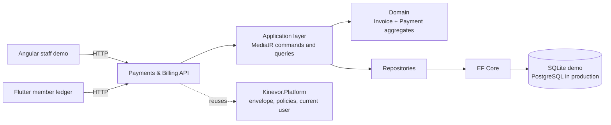
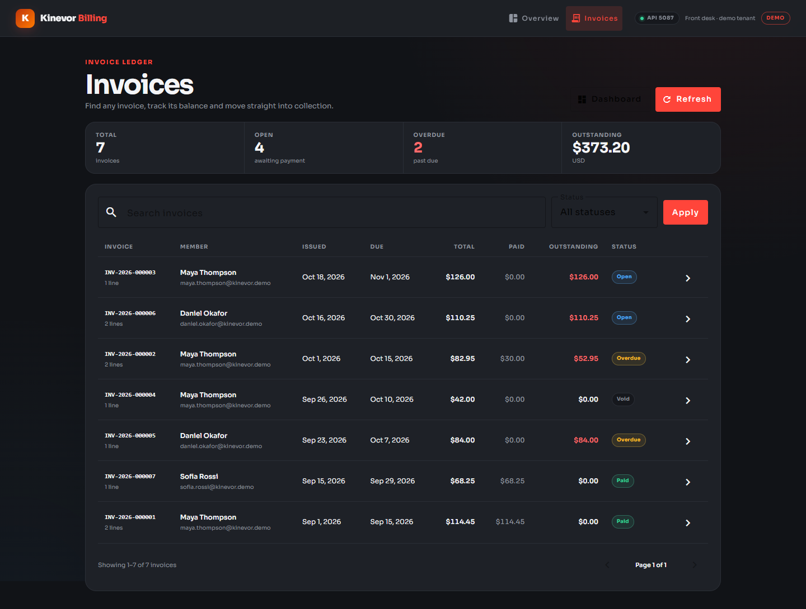
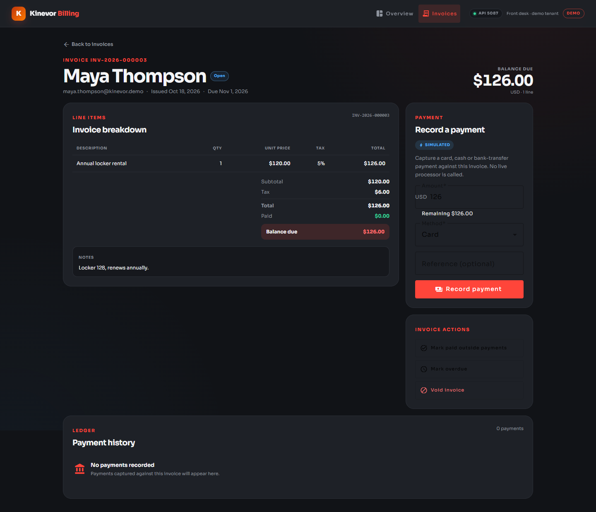
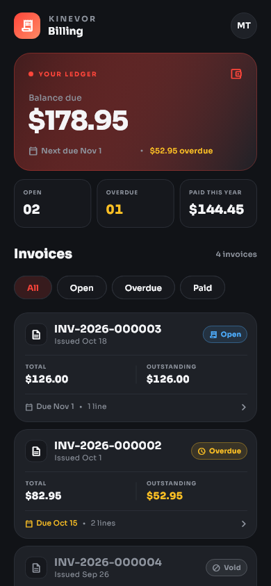
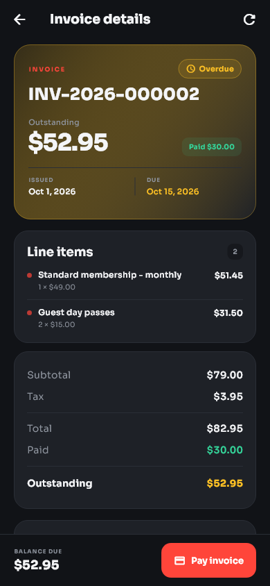
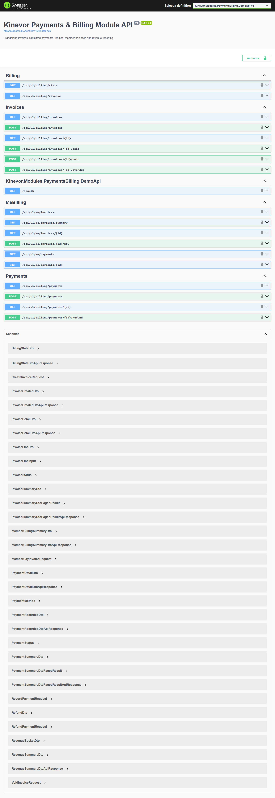

# Kinevor Payments & Billing

Invoices, simulated payments, refunds and revenue reporting for the Kinevor gym
platform: a .NET 9 API, a standalone Angular library and demo, and a Flutter
package with a runnable example. Every layer can be consumed independently, and
the demo runs locally without the original Kinevor monorepo.

[](https://github.com/SoftwareDeveloper98/kinevor-payments-billing/actions/workflows/ci.yml)
[](https://github.com/SoftwareDeveloper98/kinevor-payments-billing/pkgs/nuget/Kinevor.Modules.PaymentsBilling)
[](https://github.com/SoftwareDeveloper98/kinevor-payments-billing/pkgs/npm/kinevor-payments-billing-web)
[](https://flutter.dev)
[](LICENSE)


## Why this module

Payments & Billing owns the money trail: what a member was charged, what they
paid, what is still outstanding, what was refunded and how the month is
performing. This repository packages that slice for staff and member-facing
applications.

- Staff dashboard with invoice health, collections, refunds and revenue trend.
- Searchable, filterable, paged invoice ledger.
- Invoice detail with line items, totals, notes, payments and refund workflow.
- Record simulated card, cash and bank-transfer payments; mark paid or overdue;
  void an unpaid invoice; refund all or part of a captured payment.
- Member billing summary and invoice self-service in Angular hosts and Flutter.
- Domain invariants for totals, tax, overpayments, refunds and lifecycle changes.
- SQLite demo with seven invoices, three payments and one refund.
- Angular and Flutter clients share the same API contract.

## Architecture



The backend is organized into domain/application/API folders within a single project, with a separate EF Core persistence project. It depends
on the published `Kinevor.Platform.*` packages for the response envelope,
authorization policies, clock and current-user abstractions. The Angular and
Flutter clients are thin presentation layers over a typed gateway/repository.

## Features

- Dashboard totals: open and overdue counts, outstanding balance, collections,
  refunds, net revenue and the default six-month revenue trend.
- Invoice filters for free-text search, status and paging, with staff and member
  scopes enforced at query level.
- Invoice creation with up to 50 lines, per-line quantity, unit price and tax
  rate, ISO currency validation and derived subtotal/tax/total.
- Payment recording with reference idempotency, invoice ownership checks,
  outstanding-balance checks and simulated methods (`Card`, `Cash`,
  `BankTransfer`).
- Full or partial refunds with reason, remaining-refundable validation and
  captured/refunded/net projections.
- Invoice lifecycle actions: mark paid, mark past-due overdue and void with a
  reason. Paid invoices cannot be voided; void invoices cannot be paid.
- Member invoice summary, list, detail and self-service payment.
- Angular: standalone components, Material UI, typed gateway/facade, injectable
  providers, routes and Vitest tests.
- Flutter: injectable repository/client, member ledger and detail screens,
  simulated payment sheet, golden tests and a runnable example.
- SQLite demo with staff and member seed stories, plus Swagger.

## Endpoints

| Method | Route | Policy | Used by |
| --- | --- | --- | --- |
| `GET` | `/api/v1/billing/stats` | `StaffOrAdmin` | Staff dashboard |
| `GET` | `/api/v1/billing/revenue?from=&to=` | `StaffOrAdmin` | Revenue trend |
| `GET` | `/api/v1/billing/invoices?search=&status=&page=&pageSize=` | `StaffOrAdmin` | Invoice ledger |
| `GET` | `/api/v1/billing/invoices/{id}` | `StaffOrAdmin` | Invoice detail |
| `POST` | `/api/v1/billing/invoices` | `StaffOrAdmin` | Invoice creation |
| `POST` | `/api/v1/billing/invoices/{id}/paid` | `StaffOrAdmin` | Mark paid |
| `POST` | `/api/v1/billing/invoices/{id}/void` | `StaffOrAdmin` | Void invoice |
| `POST` | `/api/v1/billing/invoices/{id}/overdue` | `StaffOrAdmin` | Mark overdue |
| `GET` | `/api/v1/billing/payments?search=&status=&method=&page=&pageSize=` | `StaffOrAdmin` | Payment ledger |
| `GET` | `/api/v1/billing/payments/{id}` | `StaffOrAdmin` | Payment detail |
| `POST` | `/api/v1/billing/payments` | `StaffOrAdmin` | Record payment |
| `POST` | `/api/v1/billing/payments/{id}/refund` | `StaffOrAdmin` | Refund |
| `GET` | `/api/v1/me/invoices` | `MemberOrAbove` | Member invoice list |
| `GET` | `/api/v1/me/invoices/summary` | `MemberOrAbove` | Member balance |
| `GET` | `/api/v1/me/invoices/{id}` | `MemberOrAbove` | Member invoice detail |
| `POST` | `/api/v1/me/invoices/{id}/pay` | `MemberOrAbove` | Member payment |
| `GET` | `/api/v1/me/payments` | `MemberOrAbove` | Member payments |
| `GET` | `/api/v1/me/payments/{id}` | `MemberOrAbove` | Member payment detail |
| `GET` | `/health` | anonymous | Demo health check |
| `GET` | `/swagger` | development only | API explorer |

All responses use the platform `ApiResponse<T>` envelope. Enum values are
serialized as strings, so clients send and receive `Open`, `Overdue`, `Paid`,
`Void`, `Card`, `Cash` and `BankTransfer`. Paged responses expose `items`,
`totalCount`, `page`, `pageSize`, `totalPages`, `hasNext` and `hasPrev`.

The revenue endpoint defaults to the current month plus the previous five
months. It accepts an explicit `from`/`to` period of at most 24 months.

## Screenshots

### Web

| Dashboard | Invoice ledger |
| --- | --- |
|  |  |

| Invoice detail |
| --- |
|  |

### Flutter

| Member invoices | Invoice detail |
| --- | --- |
|  |  |

### API



## Quick start

### Prerequisites

- .NET SDK 10.0.100+ (pinned by `global.json`) and an ASP.NET Core 9.0+ runtime.
- Node.js 22+ and npm 10+.
- Flutter 3.35+ (the repository is verified with Flutter 3.47.7).

### 1. Build the platform packages

The backend restores `Kinevor.Platform.*` from the sibling platform repository's
local package feed. Clone it next to this repository and pack it once:

```powershell
git clone https://github.com/SoftwareDeveloper98/kinevor-platform.git ..\kinevor-platform
dotnet pack ..\kinevor-platform\backend\Kinevor.Platform.slnx -c Release `
  -o ..\kinevor-platform\backend\artifacts\packages
```

If the platform packages are published to GitHub Packages, configure that source
instead and skip the local pack step.

### 2. Run the API

```powershell
dotnet restore backend\Kinevor.Modules.PaymentsBilling.slnx
dotnet run --project backend\samples\Kinevor.Modules.PaymentsBilling.DemoApi
```

The API listens on `http://localhost:5087`. Open
`http://localhost:5087/swagger` for the explorer. The demo creates a SQLite
database and seeds this billing story on first run:

| Invoice | Member | Status | Total | Outstanding |
| --- | --- | --- | ---: | ---: |
| `INV-2026-000001` | Maya Thompson | Paid | 114.45 | 0.00 |
| `INV-2026-000002` | Maya Thompson | Overdue | 82.95 | 52.95 |
| `INV-2026-000003` | Maya Thompson | Open | 126.00 | 126.00 |
| `INV-2026-000004` | Maya Thompson | Void | 42.00 | 0.00 |
| `INV-2026-000005` | Daniel Okafor | Overdue | 84.00 | 84.00 |
| `INV-2026-000006` | Daniel Okafor | Open | 110.25 | 110.25 |
| `INV-2026-000007` | Sofia Rossi | Paid | 68.25 | 0.00 |

Seed payments include a card payment, a cash part-payment and a bank transfer;
the Sofia payment has a recorded refund. Across all members the demo starts with
`373.20` outstanding and `136.95` overdue. Maya is the primary self-service
member:

| Member | ID | Outstanding | Overdue | Open invoices |
| --- | --- | ---: | ---: | ---: |
| Maya Thompson | `11111111-1111-1111-1111-111111111111` | 178.95 | 52.95 | 2 |
| Sofia Rossi | `33333333-3333-3333-3333-333333333333` | 0.00 | 0.00 | 0 |

The demo trusts development-only headers:

| Header | Purpose | Example |
| --- | --- | --- |
| `X-Demo-Role` | Selects the authenticated role | `Staff`, `Member`, `Admin` |
| `X-Demo-Email` | Sets the current user e-mail | `billing.demo@kinevor.local` |
| `X-Demo-Member` | Binds a member identity | Maya's GUID above |
| `X-Demo-Branch` | Selects the branch context | branch GUID |

These headers are a demo adapter only. Never enable them in production.

### 3. Run the web demo

For local development, build the platform web package once:

```powershell
cd ..\kinevor-platform\web
npm install
npm run build
cd ..\..\kinevor-payments-billing\web
npm run install:local
npm start
```

`npm run install:local` temporarily points the workspace at the local platform
build, installs dependencies, restores `package.json`, and removes the generated
lockfile. When the package is published to GitHub Packages, authenticate the
scope in `.npmrc` and use the normal path instead:

```powershell
cd web
npm install
npm start
```

The web demo runs at `http://localhost:4206` with routes:

- `/billing` - invoice health, collections, refunds and revenue trend
- `/billing/invoices` - searchable, filterable invoice ledger
- `/billing/invoices/:id` - line items, payments, refunds and invoice actions

The demo interceptor sends the `Staff` role. A real host supplies its own
authentication and platform configuration.

### 4. Run the Flutter example

```powershell
cd mobile\packages\kinevor_payments_billing
flutter pub get
cd example
flutter run -d windows
```

The example targets `http://localhost:5087/api/v1` by default and authenticates
as Maya. Override it for an emulator or remote host:

```powershell
flutter run -d chrome `
  --dart-define=KINEVOR_API_BASE_URL=http://localhost:5087/api/v1
```

On an Android emulator use `http://10.0.2.2:5087/api/v1`. The demo API allows the
Angular origin `http://localhost:4206`; add your host origin before running the
Flutter web example from another port.

### 5. Refresh screenshots

With both servers running:

```powershell
cd web
npm run capture:screenshots
```

The Playwright script writes the web and API images to `docs/screenshots`.
Regenerate the Flutter goldens with:

```powershell
cd mobile\packages\kinevor_payments_billing
flutter test --update-goldens test\billing_golden_test.dart
Copy-Item test\goldens\invoice_list.png ..\..\..\docs\screenshots\mobile-invoice-list.png -Force
Copy-Item test\goldens\invoice_detail.png ..\..\..\docs\screenshots\mobile-invoice-detail.png -Force
```

## Testing

| Area | Command |
| --- | --- |
| Backend | `dotnet test backend\Kinevor.Modules.PaymentsBilling.slnx -c Release` |
| Web unit tests | `cd web; npm test` |
| Web builds | `cd web; npm run build:all` |
| Flutter analysis | `cd mobile\packages\kinevor_payments_billing; flutter analyze` |
| Flutter tests | `cd mobile\packages\kinevor_payments_billing; flutter test` |

The backend suite has 21 tests covering domain invariants, invoice endpoints,
payment idempotency, refunds, member ownership and authorization. The web suite
has 13 Vitest tests across the gateway, facade and three screens. The Flutter
suite has 15 tests covering models, HTTP client, screens, payment flow and two
golden images.

## Packages

| Ecosystem | Package | Contents |
| --- | --- | --- |
| NuGet | `Kinevor.Modules.PaymentsBilling` | Domain, application, API controllers and module registration |
| NuGet | `Kinevor.Modules.PaymentsBilling.EntityFrameworkCore` | `PaymentsBillingDbContext`, mapping and repositories |
| npm | `@softwaredeveloper98/kinevor-payments-billing-web` | Angular dashboard, ledger, detail, gateway, facade, providers and routes |
| Flutter | `kinevor_payments_billing` | API client, repository, member screens, theme and strings |

Install the Angular lib after authenticating to GitHub Packages:

```powershell
npm install @softwaredeveloper98/kinevor-payments-billing-web
```

Consume the Flutter package from the repository tag:

```yaml
dependencies:
  kinevor_payments_billing:
    git:
      url: https://github.com/SoftwareDeveloper98/kinevor-payments-billing.git
      path: mobile/packages/kinevor_payments_billing
      ref: v0.1.0
```

Both clients use the same API contract. The Angular package expects
`@softwaredeveloper98/kinevor-platform-web` as a peer dependency.

CI restores the platform NuGet and npm packages from GitHub Packages. Publish
`kinevor-platform` `0.1.0` first, or the backend and web jobs will fail at
restore/install.

## Design decisions

- **Totals are derived.** `Invoice` recalculates subtotal, tax and total from its
  lines; callers cannot submit a mismatched total.
- **Money is guarded.** ISO currency validation, positive amounts, overpayment
  checks and refundable-balance checks live in the aggregates.
- **Ownership is part of the query.** Member routes never trust an id alone; the
  authenticated member id is pushed into every invoice and payment lookup.
- **Payment references are idempotent.** Repeating the same reference, amount,
  member, invoice and method returns the recorded result; a conflicting reuse is
  rejected.
- **Refunds are payment-led.** Refund history belongs to the captured payment,
  with partial and full states derived from the refunded amount.
- **Thin clients.** Angular facades own loading and action state; the Flutter
  package injects a repository so hosts can swap the HTTP implementation.
- **Demo auth is explicit.** Trust headers exist only in Development and are sent
  by the demo interceptor/client.
- **Visual contract in tests.** Playwright and Flutter goldens make layout,
  typography and icon regressions visible.

## Scope and limitations

- Payments are simulated. There is no Stripe or acquiring-bank integration, PCI
  data handling, settlement import or reconciliation.
- Captured payments and reporting are USD-only. Invoices can validate other ISO
  currency codes, but the payment command rejects anything except `USD`.
- Refunds do not reopen the invoice or reduce `AmountPaid`; invoice balances and
  refunds are separate ledgers. Hosts must reconcile any accounting reversal.
- The Angular library does not include an invoice-creation form; creation is
  available through the API.
- There is no PDF rendering, e-mail delivery, dunning automation, subscription
  engine, tax engine or multi-currency conversion.
- Revenue periods are capped at 24 months. The default dashboard window is six
  months.
- Member self-service is exposed in Flutter; the Angular demo is the staff view.

## Repository layout

```text
kinevor-payments-billing/
  backend/
    src/Kinevor.Modules.PaymentsBilling/          domain, application, API
    src/Kinevor.Modules.PaymentsBilling.EntityFrameworkCore/
    samples/Kinevor.Modules.PaymentsBilling.DemoApi/
    tests/Kinevor.Modules.PaymentsBilling.Tests/
  web/
    projects/kinevor-payments-billing/             Angular library
    projects/demo/                                 demo host
    scripts/                                       local install + screenshots
  mobile/
    packages/kinevor_payments_billing/             Flutter package
    packages/kinevor_payments_billing/example/     runnable demo
  docs/
    screenshots/
  .github/workflows/
```

## Related modules

- [Kinevor Platform](https://github.com/SoftwareDeveloper98/kinevor-platform) -
  shared API, auth, i18n, notices and Angular primitives.
- [Kinevor Identity & Access](https://github.com/SoftwareDeveloper98/kinevor-identity-access)
- [Kinevor Trainers](https://github.com/SoftwareDeveloper98/kinevor-trainers)
- [Kinevor Members](https://github.com/SoftwareDeveloper98/kinevor-members)
- [Kinevor Memberships](https://github.com/SoftwareDeveloper98/kinevor-memberships)
- [Kinevor Classes & Bookings](https://github.com/SoftwareDeveloper98/kinevor-classes-bookings)
- [Kinevor Check-ins & Access](https://github.com/SoftwareDeveloper98/kinevor-checkins-access)
- [Kinevor Notifications](https://github.com/SoftwareDeveloper98/kinevor-notifications)
- [Kinevor Public Site](https://github.com/SoftwareDeveloper98/kinevor-public-site)
- [Kinevor Staff Dashboard](https://github.com/SoftwareDeveloper98/kinevor-staff-dashboard)

## Release Checklist

- Confirm `kinevor-platform` `v0.1.0` is published.
- Add the `KINEVOR_PACKAGES_TOKEN` repository secret.
- Push tag `v0.1.0` after CI is green.

See [PUBLISHING.md](PUBLISHING.md) for the complete release and consumer setup.

## Security

The demo role headers are intentionally insecure and exist only for local
screenshots and tests. Production hosts must use the platform authentication
stack, enforce the published policies, and keep the demo adapter disabled.
Protect payment and member data with transport encryption, least-privilege access
and audit logging. Do not commit connection strings, PATs or `.env` files.

## License

MIT. See [LICENSE](LICENSE).
